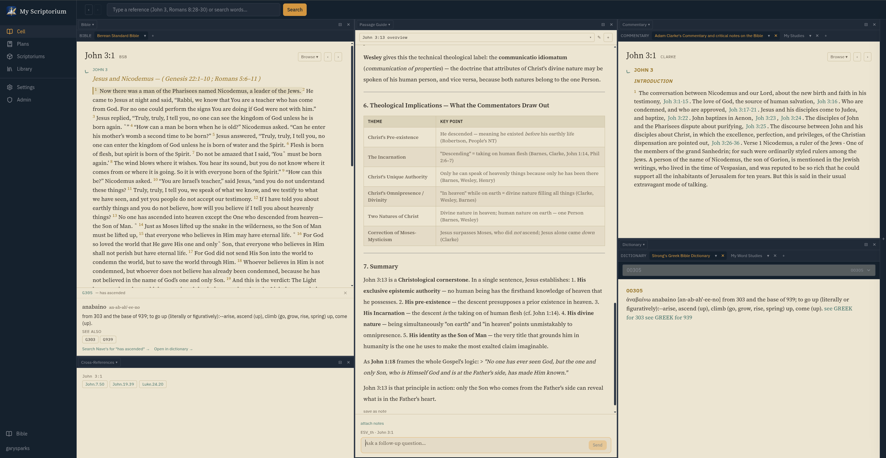
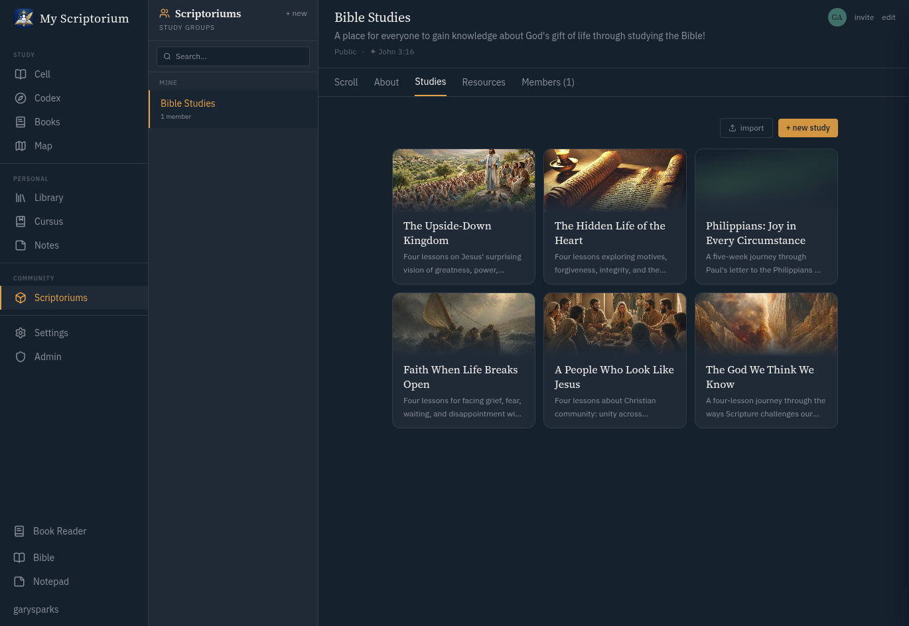
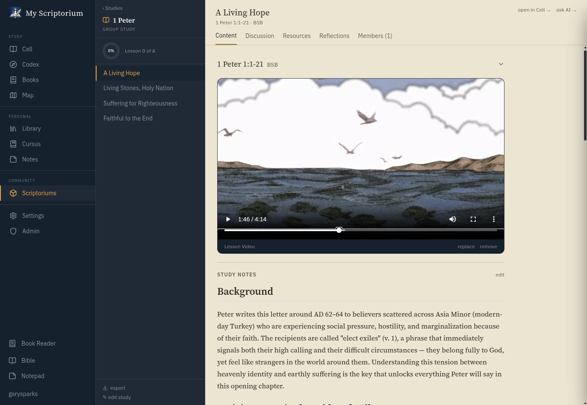

<p align="center">
  
</p>

<h1 align="center">Scriptorium</h1>
<p align="center">A self-hosted, multi-user Bible study platform built on the CrossWire SWORD engine.</p>

<p align="center">
  
  
    
</p>

Scriptorium is a self-hosted Bible study environment: real text from the SWORD engine (same library behind Ezra Bible App and Xiphos), an LLM study assistant grounded in the passages you actually have open, structured multi-week Studies with AI-drafted lesson outlines, and small-group coordination through Scriptoriums — all from one Docker container.

## What's in here

- **Cell (Reader)** — tiled, tabbed panes for Bibles, commentaries, dictionaries, cross-references, a Passage Guide, and more. Panes are resizable, reorderable by drag (desktop), and support parallel translations side-by-side.
- **Interlinear mode** — toggle any Bible pane into a word-by-word interlinear view showing the English word, Strong's number, and transliteration beneath each tagged word.
- **Full-text Bible search** — "all words" or "exact phrase" across any installed module; results show highlighted matches, a count, and clicking any result navigates the Bible pane.
- **Codex** — topical reference search across all installed SWORD dictionaries, Markdown modules, General Books, Wikipedia, and Merriam-Webster, with an AI-generated overview for any term.
- **AI Companion** — a study assistant fed by whatever passages, commentaries, and notes you have open. Word Study and Phrase Study target a single Greek/Hebrew word or an exact phrase across the whole Bible. Save any assistant reply as a note or personal dictionary entry with one click.
- **Books** — a dedicated reader for SWORD General Books (RawGenBook format) and CCEL ThML/XML titles. A collapsible TOC sidebar auto-generates from headings; text selection shows a colour-highlight bar and a note button; saved notes appear as inline markers with hover previews.
- **Bible Maps** — a gallery of 540+ Biblica Open Bible Maps (OT and NT); maps relevant to the current passage surface via a pin icon in the Bible pane header.
- **Notes** — anchored to a passage or freestanding, full Markdown editor, searchable, with a "save as note" button on any assistant reply. Select any text in the reader to create a quoted note.
- **Personal modules** — your own commentary entries or dictionary definitions, saved and looked up exactly like a real SWORD module.
- **Markdown modules** — drop a folder of `.md` files into `MD_MODULES_PATH` and it appears in the pane module pickers alongside SWORD modules (no compilation required). Supports commentary, dictionary, Bible text, and book types.
- **Cursus** — structured daily reading schedules with per-day completion tracking and one-click passage navigation.
- **PDF library** — upload reference PDFs and search their extracted text alongside Bible text and notes.
- **Scriptoriums** — invite-only or public study groups with a group feed, Studies, Resources, Members management, and a Daily Devotional sidebar.
- **Studies** — structured multi-week studies inside a Scriptorium or solo: lessons with leader notes, per-lesson completion, threaded discussion, attached resources, and AI-drafted lesson outlines.
- **Fellows** — follow other users and send connection requests; search users by name.
- **Admin** — module installation from CrossWire repositories, per-module visibility controls, user management, instance branding, and a metrics dashboard.
- **Mobile layout** — responsive single-pane view on small screens with a scrollable tab strip; all sidebar-detail views (Books, Library, Notes, Cursus, Scriptoriums, Codex) switch to a list → detail navigation pattern on mobile.

## Stack

- **Backend**: Node.js 20 / Express + [`node-sword-interface`](https://github.com/ezra-bible-app/node-sword-interface) (native bindings to `libsword`)
- **Database**: PostgreSQL 16 via Prisma ORM
- **Frontend**: React 18 + Vite + Tailwind CSS
- **Auth**: cookie sessions (30-day rolling), argon2-hashed passwords, single-admin bootstrap, rate-limited login
- **LLM**: Anthropic API (Claude), used by Study Assistant, Word/Phrase Study, Codex AI overview, and AI-generated lesson drafts
- **Maps**: [Biblica Open Bible Maps](https://github.com/BibleAquifer/BiblicaOpenBibleMaps) submodule — 540+ PNG maps served from the backend

## Running it

```bash
cp .env.example .env
# edit .env: set POSTGRES_PASSWORD and SESSION_SECRET,
# plus ANTHROPIC_API_KEY if you want the AI features

docker compose up --build
```

Then open **http://localhost:8088**.

⚠️ **First build is slow.** `node-sword-interface` compiles the SWORD C++ engine from source during `npm install` — expect several minutes on first build. Rebuilds are fast (Docker layer caching keeps the compiled engine unless `backend/package.json` changes).

## First run

1. **Bootstrap the admin account.** The app detects there are no users yet and prompts you to create the first account (becomes the instance admin). All subsequent accounts are regular users.
2. **Modules are auto-seeded.** On startup the container installs KJV, BSB, TSK (cross-references), Clarke's Commentary, Strong's Greek/Hebrew, and Henry Alford's New Testament commentary from the CrossWire repository. Additional modules are installed via **Admin → Modules**.
3. Open the **Cell** to start reading.

## The Cell — reader panes

The Cell is a small window manager. Panes tile into resizable columns and rows; dragging a pane's header repositions it on desktop. On mobile, a horizontal tab strip replaces the tiling — tapping an open pane switches to it; tapping a closed pane opens it.

**Pane types:**

| Pane | What it does |
|---|---|
| Bible | Primary reading with Strong's tags, highlights, notes, verse selection, interlinear toggle |
| Commentary | SWORD or Markdown commentary text following the active reference |
| Dictionary | Browse or search SWORD/Markdown dictionary entries; Strong's and cross-ref links are clickable |
| Cross-References | Human-readable TSK cross-reference list (e.g. `John 3:16`, not `John.3.16`) with hover verse previews |
| Passage Guide | AI study assistant contextualised to the open passage |
| Documents | PDF viewer for uploaded reference books |
| Search Results | Full-text search across Bible text, notes, and PDFs |
| Links | External reference links |

**Within each pane:**

- **Tabs** — open multiple modules in the same pane; each tab keeps its own scroll position.
- **Parallel translations** — add a second (or third) translation alongside the active one inside a single Bible pane.
- **Sync groups** — the coloured dot on a pane header assigns it to a sync group (A, B, or C). Panes in the same group navigate together.

**Keyboard shortcuts (Cell):**

| Key | Action |
|---|---|
| `/` | Focus the search / reference bar |
| `←` / `→` | Previous / next chapter |
| `Ctrl+B` | Toggle Quick Bible panel |
| `Ctrl+K` | Toggle Book Reader panel |
| `Ctrl+`` ` `` ` | Toggle Quick Note panel |
| `Escape` | Close open panel |

## Reference parsing

`swordService.getPassage` handles anything `bible-passage-reference-parser` can parse:

- Single verse: `John 3:16`
- Range: `Romans 8:28-30`, cross-chapter: `John 3:16-4:2`
- Whole chapter: `John 3`
- Comma-separated: `John 3:16, 18` or `John 3:16-18, Romans 8:28`

The search bar auto-detects a valid reference and navigates directly; non-reference queries run a full-text search.

## Strong's, cross-references, footnotes

- Every Strong's-tagged word is clickable — definition, Greek/Hebrew text, transliteration, morphology, and "see also" cross-references open in a drawer.
- **Interlinear mode** — toggle the `⊞` button in any Bible pane to see a word-by-word stacked view: English word on top, Strong's number in the middle (clickable), transliteration below.
- Cross-references collapse to lettered superscript markers; clicking one opens a list with human-readable references and a verse text snippet on hover.
- Footnotes show the translator's note inline without a network round-trip.
- Dictionary entries in SWORD modules (Vine's, etc.) have clickable Strong's numbers and cross-reference links.
- Bible references in commentary and dictionary prose are detected and made clickable.
- Augmented Strong's numbers (H9001+, outside the original lexicon range) are silently skipped rather than showing an error.

## Notes and text selection

- **Verse selection** — click any verse number to select it; shift-click to extend the range. A toolbar appears with highlight colour swatches, a Note button, Copy, and "Ask about this →".
- **Text selection** — drag to select any span of words. A toolbar appears with Note, phrase study buttons, and highlight swatches.
- **Highlight colours** — five colours (yellow, blue, green, pink, purple); highlights persist per verse reference and show as coloured verse backgrounds. A gold margin tick marks chapters that have highlights or notes.
- Notes are edited with a full Markdown editor, searchable from the Notes view or the main search bar, and can be saved directly from any assistant reply.

## Codex

The **Codex** view is a topical reference search that queries all installed resources at once:

- SWORD and Markdown dictionary modules (Strong's, Vine's, ISBE, personal dictionaries, etc.)
- Installed General Books (commentaries, reference works)
- Wikipedia (live)
- Merriam-Webster (requires `MERRIAM_WEBSTER_API_KEY`)
- **AI Overview** — Claude generates a structured summary for any term, cached after the first request

Results are grouped by source in the left panel; clicking an entry loads the full text on the right. Strong's numbers and Bible references in results are clickable. The search bar at the top of the Cell toolbar links here via the Codex icon.

## Bible Maps

The **Maps** view shows the [Biblica Open Bible Maps](https://github.com/BibleAquifer/BiblicaOpenBibleMaps) collection — 540+ PNG maps served directly from the submodule:

- **Atlas tab** (default) — general OT and NT maps grouped by series: *The Life of Jesus*, *Paul and the Early Church*, *Historical*, *Wisdom & Prophets*
- **Scripture Refs tab** — 480+ passage-specific maps keyed to individual Scripture ranges
- **Search** — filter by title across all maps
- **Passage pin** — a `📍` icon appears in the Bible pane RefNav header whenever maps exist for the currently open passage; clicking it opens a modal (fullscreen on mobile) showing the relevant maps

## Study Assistant, Word Study, and Phrase Study

The assistant and study tools live in the Passage Guide pane and the AI Companion panel.

- **Study Assistant** — persistent chat grounded in whatever passages, commentaries, and user notes are open across every reader pane. Context is rebuilt before each message. "Save as note" on any reply creates a note; the icon next to it saves a word/phrase study to My Word Studies (your personal dictionary).
- **Word Study** — click a Strong's-tagged word → takes the dictionary gloss, morphology, and every occurrence of that word across the whole Bible as context, then generates a structured study. Saved to My Word Studies with one click.
- **Phrase Study** — select any text span → study by exact English wording or by the underlying Strong's sequence (matches the original words regardless of translation).

All three require `ANTHROPIC_API_KEY` and a logged-in account.

## Books

The **Books** view and **Book Reader panel** (`Ctrl+K`) provide a dedicated environment for reading alongside your Bible study.

**Table of Contents:** Every book gets a collapsible TOC sidebar built automatically from `h1`–`h4` headings. Clicking a TOC entry smooth-scrolls to that section.

**Highlighting and notes:** Selecting text opens a toolbar with colour swatches and a note button. Highlights are re-applied on every load by text matching. Saved notes appear as teal bullet markers `•` inline; hovering reveals the note body.

**Installing book modules:**
- **SWORD RawGenBook** — install from a CrossWire repository via **Admin → Modules**.
- **CCEL ThML / XML** — zip the XML file with a `module.json` descriptor and upload via **Admin → Modules**.
- **Markdown books** — a folder with `module.json` (`"type": "BOOK"`) and `.md` content files.

## Cursus (Reading Plans)

The **Cursus** view shows reading schedules. Each plan is a day-by-day schedule of passages; clicking a day's passage link opens it in the Cell. Completion is tracked per day and shown with a progress ring.

## Scriptoriums

Study groups with:

- **Scroll** — a shared group feed (posts + comments with likes)
- **About** — rich-text description editable by the owner
- **Studies** — multi-week structured studies (see below)
- **Resources** — member-submitted links or notes
- **Members** — owner can invite, remove, and manage roles
- **Daily Devotional sidebar** — today's reading from whichever SWORD Daily module the admin has selected (Spurgeon, etc.)

Scriptoriums can be public (browse and join) or invite-only. Tags enable filtering on the list page.

## Studies

Structured studies that live inside a Scriptorium or as a private solo study:

- **Lessons** — each lesson has a key verse, leader study notes, and a personal note editor for the participant.
- **Lesson editing** — study leaders can edit lesson titles, references, and notes inline.
- **AI lesson drafts** — enter a topic and number of weeks and Claude drafts a full lesson outline.
- **Progress tracking** — mark lessons complete; a progress ring shows overall completion.
- **Discussion** — threaded comments with likes on each lesson.
- **Resources** — attach a commentary passage, a Bible module reference, a link, or a freeform note to any lesson; commentary resources fetch and display inline.
- **Export** — participants can export a study (lessons + personal notes) as a file.

## Personal modules

Private, per-user commentary notes or dictionary definitions saved through the same UI as SWORD modules. Personal commentary entries support range-overlap matching — a note saved for `John 3:16-18` surfaces when reading verse 17. Word and phrase studies save to a personal dictionary module called **My Word Studies**.

## Markdown modules

A lightweight alternative to compiled SWORD modules. Drop a folder into `MD_MODULES_PATH` (default `/data/md-modules`) — or upload a `.zip` via **Admin → Modules** — and it appears in the pane module pickers alongside SWORD modules.

**Folder layout:**

```
my-commentary/
  module.json        ← metadata
  john.md            ← content keyed by ## headings
  genesis.md
```

**`module.json`:**

```json
{
  "name": "My Commentary",
  "description": "Shown in the module picker",
  "type": "COMMENTARY"
}
```

`type` is `COMMENTARY`, `DICT`, `BIBLE`, or `BOOK`.

**Commentary and Bible text** — one `.md` file per book. Sections are `## chapter:verse` headings; `## chapter` headings are a fallback for chapter-level content.

**Dictionary** — `## Entry Name` sections in any `.md` file, or one file per entry with the filename as the key.

**Books** — prose content in one or more `.md` files, or a single `.xml` file in CCEL ThML format.

Commentary modules are automatically included in the Passage Guide AI context. An example commentary zip is at `modules/example-commentary.zip`.

## PDF library

Admins upload reference PDFs; all users can browse and search. Extracted text (capped at 200K chars per doc) is included in the main search alongside Bible text and notes. PDFs can also be attached to Scriptorium Resources and opened in the in-app reader.

## Admin

- **Modules** — install from CrossWire repositories by type (BIBLE, COMMENTARY, DICT, DAILY, GENBOOK); per-module visibility toggle for regular users; `.zip` upload for offline installs (auto-detects SWORD vs. Markdown/ThML format)
- **Daily Devotional** — select which installed Daily module shows in the Scriptorium sidebar
- **Reading Plans** — create and manage reading schedules
- **Users** — create and list user accounts
- **Branding** — set the instance display name
- **Metrics** — DB health and usage counts

## Auth model

- First run bootstraps a single admin account; all subsequent accounts are normal users.
- Sessions are cookie-based with a 30-day rolling window, backed by `connect-pg-simple`.
- `requireLogin`/`requireAdmin` middleware gates entire routers.
- Reading Bible text and the PDF library stays public; creating content or spending API credits requires login.
- Login and the bootstrap endpoint are both rate-limited (10 attempts/15 min and 5 attempts/hour respectively).
- Passwords: argon2 hashing, min 10 chars, constant-time dummy-hash check prevents username enumeration.

## Environment variables

| Variable | Default | Notes |
|---|---|---|
| `POSTGRES_PASSWORD` | — | Required |
| `SESSION_SECRET` | — | Required; generate with `openssl rand -hex 32` |
| `ANTHROPIC_API_KEY` | — | Required for AI features |
| `ANTHROPIC_MODEL` | `claude-sonnet-4-6` | |
| `SWORD_MODULES_PATH` | `/data/sword-modules` | |
| `PDF_STORAGE_PATH` | `/data/pdfs` | |
| `MD_MODULES_PATH` | `/data/md-modules` | |
| `BIBLE_MAPS_PATH` | `/data/bible-maps` | Volume-mounted from `biblicaopenbiblemaps/` |
| `MERRIAM_WEBSTER_API_KEY` | — | Optional; enables Merriam-Webster in Codex |
| `PORT` | `8088` | |

## Project layout

```
backend/
  src/
    routes/       auth, admin, bible, search, modules, strongs, dictionary,
                  notes, highlights, bookmarks, context, phrase-study,
                  word-study, pdf, personal-modules, branding, connections,
                  scriptoriums, studies, wall, users, uploads, devotionals,
                  reading-plans, books, topics (Codex), factbook (AI overview),
                  bible-maps, sword-images, merriam, wikipedia
    services/     swordService, mdModuleService, bibleMapsService,
                  contextBuilder, pdfService, authService, referenceParser,
                  scriptoriumService, studyService, wallService,
                  devotionalService, personalModuleService,
                  moduleVisibilityService, brandingService, metricsService,
                  factbookSummaryService, readingPlanService
    middleware/   auth.js, errorHandler.js, upload.js
    db/prisma.js
  prisma/schema.prisma, prisma/migrations/
frontend/
  src/
    components/   AppShell, CellView, WorkspaceLayout, MainLayout,
                  ReaderPane, DictionaryPane, CrossRefPane, PassageGuidePane,
                  StudyAssistant, AICompanionView, StrongsDrawer, VerseDrawer,
                  ScriptoriumsView, StudyDetail, StudyBuilder, StudyMode,
                  LibraryView, NotesView, CursusView, BooksView, BookPane,
                  TopicGuidePane (Codex), BiblicaMapsView, PassageMapsModal,
                  BiblePanel, BookPanel, NotePanel, AdminView, SettingsView,
                  and more
    hooks/        useAuth, useWorkspaceLayout, useTabbedWindow,
                  useResizableWidth/Height
    utils/        osisToHuman, parseInterlinear, abbreviateTitle,
                  bookHtml, dictHtml, robinsonMorphology
    api/client.js thin fetch wrapper — one method per backend endpoint
biblicaopenbiblemaps/  git submodule — Biblica Open Bible Maps PNG assets
```

## Known limitations

- **Module install is synchronous** — the HTTP request blocks until the download finishes. Large modules can take a while with no progress feedback.
- **PDF search** uses a basic `ILIKE` query; swap `pdfService.searchDocuments` for Postgres full-text search once the library grows.
- **No built-in TLS** — put a reverse proxy in front before exposing this to the open internet.
- **Book highlight re-application** uses first-match text search; highlights on duplicate text passages will always land on the first occurrence.

## Design

Dark ink/parchment palette with a brass accent for primary actions and a verdigris accent for cross-references and annotations. Source Serif 4 for display text, IBM Plex Sans for UI, IBM Plex Mono for module codes and references. Responsive at the `lg` Tailwind breakpoint (1024px).
